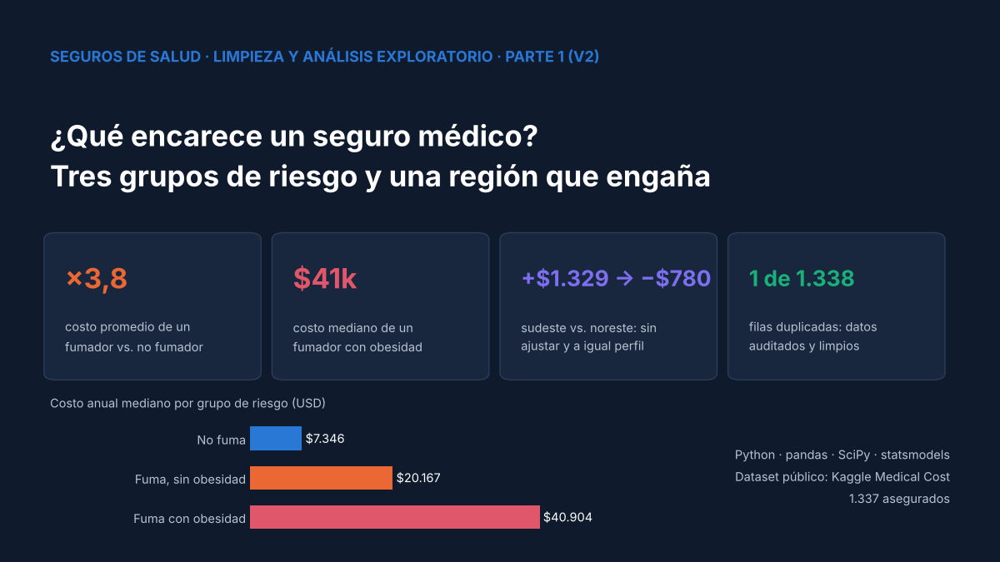
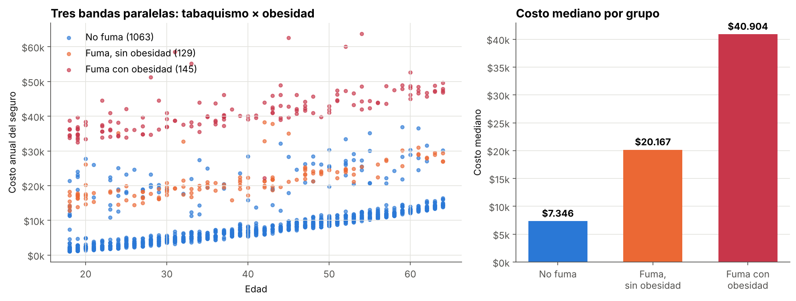
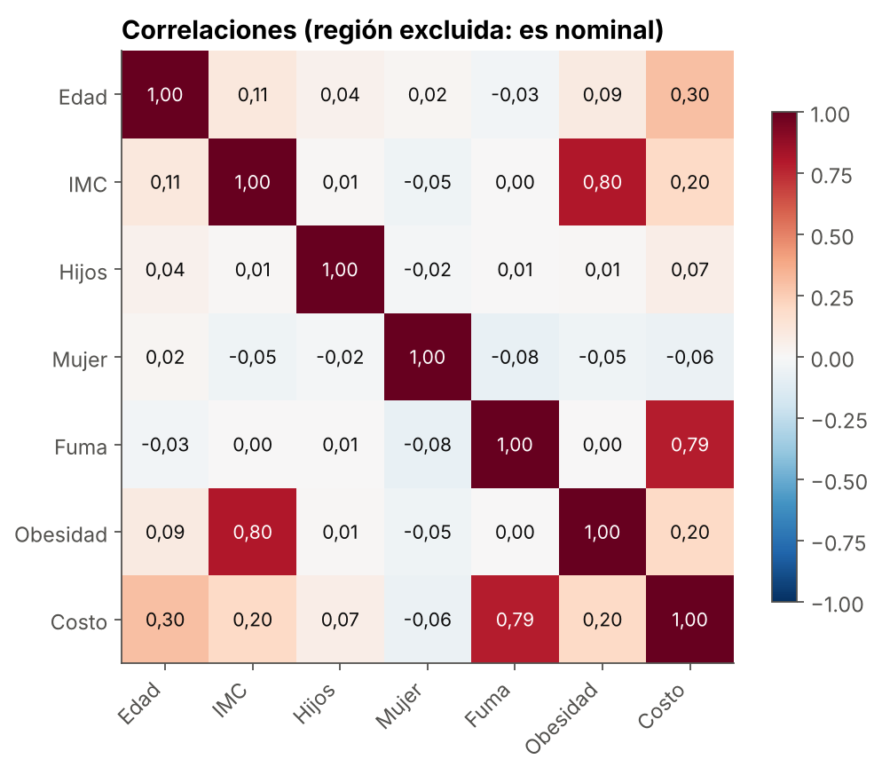
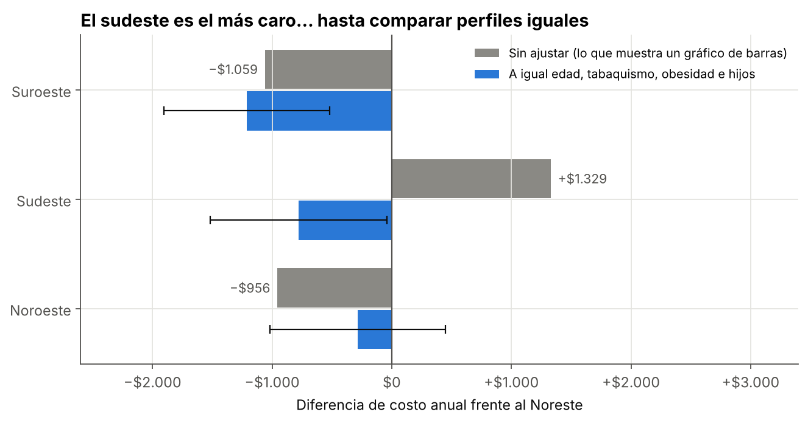

# 🩺 Costos de seguro médico · Parte 1: limpieza y análisis exploratorio

> **Versión 2.** Auditoría y limpieza de un dataset de seguros médicos, el hallazgo de **tres grupos de costo** (tabaquismo × obesidad) y la corrección de una conclusión sobre regiones: el sudeste parece el más caro, pero a igual perfil la diferencia se invierte.




**Serie de dos partes:** Parte 1 (este repositorio) · [Parte 2: regresión lineal →](https://github.com/Cristobal-111/regresion-lineal-seguros)

---

## 🎯 Objetivo

Antes de construir un modelo de tarificación, entender **qué explica el costo anual del seguro médico**: auditar y limpiar los datos, transformar variables correctamente y responder preguntas de negocio con evidencia.

## 🔁 Qué cambió respecto de la versión 1

| | Versión 1 | Versión 2 |
|---|---|---|
| Codificación de región | 0, 1, 2, 3 (incluida en la correlación) | **One-hot** (es nominal, no tiene orden) |
| ¿Diferencias entre regiones? | "No significativas", sin prueba | **ANOVA, Kruskal-Wallis y comparación a igual perfil** |
| Hallazgo principal | Fumar multiplica el costo ×3,8 | **Tres grupos**: la obesidad pesa solo en fumadores |
| Entregable | Script `.py` | Notebook ejecutado con resultados y explicación |

La versión 1 se conserva en [`version_original/`](version_original/).

## 🧹 Auditoría y limpieza

- **1.338 registros**, 7 variables, **sin faltantes**, sin valores negativos ni fuera de rango.
- **1 duplicado exacto** (hasta en los centavos del costo), eliminado: quedan 1.337.
- `sex` y `smoker` → 0/1 · `region` → **one-hot** · nuevas variables `obesidad` (IMC ≥ 30, umbral OMS) y `grupo_riesgo`.
- El dataset limpio se guarda en `data/insurance_cleaned.csv`.

## 📊 Hallazgo central: tres grupos de costo



| Grupo | Asegurados | Costo mediano | Costo promedio vs. no fumar |
|---|---|---|---|
| No fuma | 1.063 (79,5 %) | $7.346 | 1,0× |
| Fuma, sin obesidad | 129 (9,6 %) | $20.167 | 2,5× |
| Fuma con obesidad | 145 (10,8 %) | $40.904 | 4,9× |

Fumar multiplica el costo promedio por 3,8, pero los fumadores se separan en **dos bandas según la obesidad**. Dentro de cada banda, el costo sube con la edad de forma casi lineal. Este patrón es la base del modelo de la Parte 2.

## 🔢 Corrección 1: la región no es un número



Codificar `northeast = 0 … southwest = 3` hace que la "correlación" dependa del orden alfabético. La matriz corregida excluye la región. Fumar es lo más asociado al costo (0,79); la obesidad aparece baja (0,20) porque su efecto existe casi solo en fumadores, y una correlación no puede mostrar esa interacción.

## 🗺️ Corrección 2: el sudeste no es más caro

| Prueba | Resultado |
|---|---|
| ANOVA (medias) | p = 0,033 → las medias **sí** difieren |
| Kruskal-Wallis (medianas) | p = 0,202 → el asegurado típico cuesta parecido |

El sudeste tiene más fumadores (25 %) y más obesidad (67 %). Comparando **a igual edad, tabaquismo, obesidad e hijos**:



Sin ajustar, el sudeste cuesta **+$1.329** más que el noreste; a igual perfil, cuesta **−$780** (IC 95 %: −$1.518 a −$42). La región no encarece el seguro: lo hace la **composición de riesgo**, un caso de paradoja de Simpson.

## 🗂️ Estructura del repositorio

```
medical-insurance-project/
├── data/
│   ├── insurance.csv            # Dataset original
│   └── insurance_cleaned.csv    # Dataset limpio (generado por el notebook)
├── images/                      # Gráficos de la versión 2
├── notebooks/
│   └── analisis_exploratorio_seguros_v2.ipynb
├── version_original/            # Scripts y gráficos de la versión 1
├── requirements.txt
├── LICENSE
└── README.md
```

## ▶️ Cómo reproducirlo

```bash
git clone https://github.com/Cristobal-111/medical-insurance-project.git
cd medical-insurance-project
pip install -r requirements.txt
jupyter notebook notebooks/analisis_exploratorio_seguros_v2.ipynb
```

## ⚠️ Limitaciones

- Datos de EE. UU. con fines educativos; sin identificador de asegurado ni historial clínico.
- Las diferencias ajustadas son asociaciones, no efectos causales.

## 📚 Fuente de datos

[Medical Cost Personal Datasets — Kaggle](https://www.kaggle.com/datasets/mirichoi0218/insurance) · basado en *Machine Learning with R* (Brett Lantz).

Proyecto desarrollado en el marco del **Google Advanced Data Analytics Professional Certificate**.

## 👤 Autor

**Cristóbal Rojas Troncoso** · Ingeniero Civil Industrial | Inteligencia de negocios y análisis de datos
[LinkedIn](https://www.linkedin.com/in/cristobal-rojas-troncoso/) · [GitHub](https://github.com/Cristobal-111)
