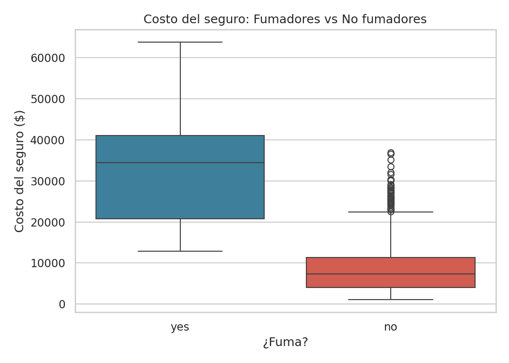
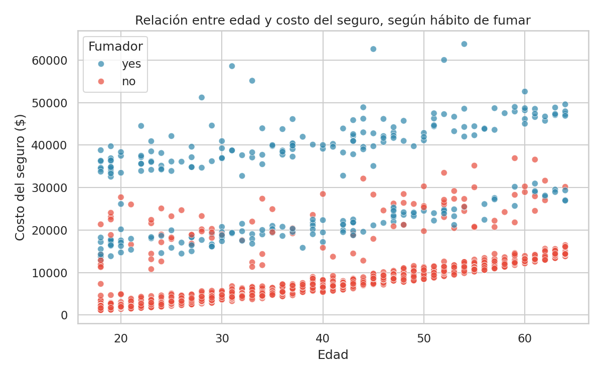
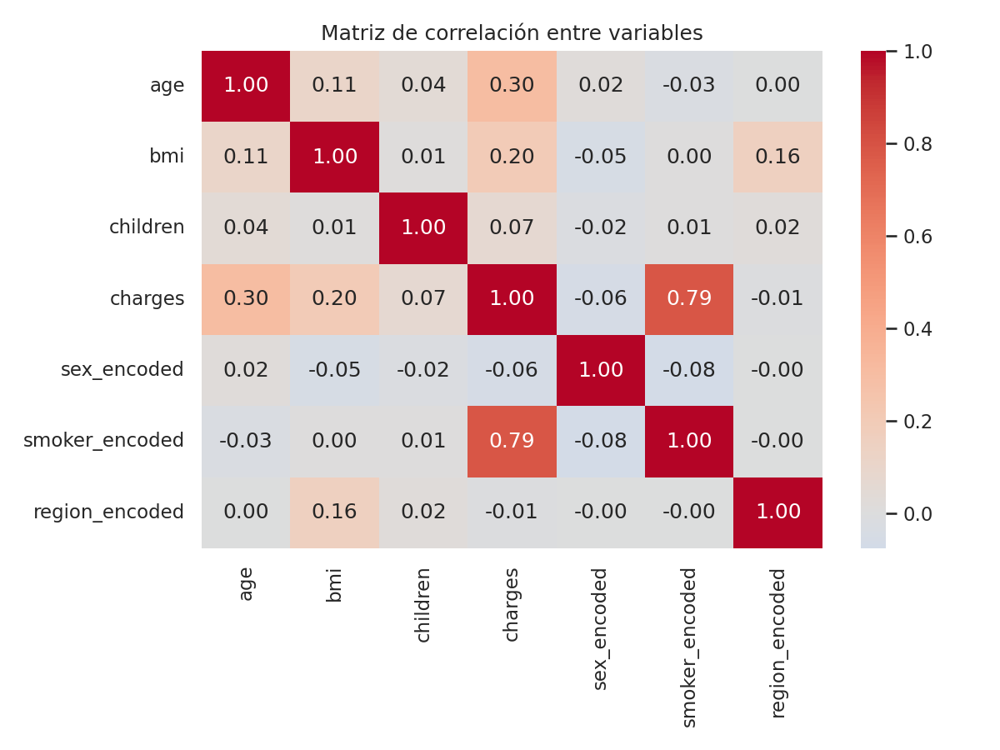

# 🏥 Medical Insurance Cost Analysis

Proyecto personal de práctica de **limpieza, validación y análisis exploratorio de datos (EDA)**, desarrollado en el marco del **Google Advanced Data Analytics Professional Certificate**.

El objetivo es tomar un dataset "crudo" de costos de seguros médicos y aplicar un flujo completo de trabajo típico de un analista de datos: exploración, detección de problemas, limpieza, transformación de variables y visualización de insights.

## 📌 Objetivo del proyecto

- Explorar y diagnosticar la calidad de un dataset real (duplicados, valores faltantes, inconsistencias).
- Limpiar y estandarizar los datos.
- Transformar variables categóricas a numéricas (Label Encoding y One-Hot Encoding).
- Generar visualizaciones que respondan preguntas de negocio: ¿qué factores influyen más en el costo del seguro?

## 🗂️ Estructura del repositorio

```
insurance-project/
├── data/
│   ├── insurance.csv           # Dataset original
│   └── insurance_cleaned.csv   # Dataset limpio y transformado (output del script)
├── images/                     # Gráficos generados por el script
├── src/
│   └── data_cleaning_and_analysis.py
├── requirements.txt
└── README.md
```

## 📊 Dataset

El dataset contiene **1,338 registros** con las siguientes columnas:

| Columna    | Descripción                                  |
|------------|-----------------------------------------------|
| `age`      | Edad del asegurado                            |
| `sex`      | Sexo (male / female)                          |
| `bmi`      | Índice de masa corporal                       |
| `children` | Número de hijos/dependientes                  |
| `smoker`   | ¿Fuma? (yes / no)                             |
| `region`   | Región de residencia en EE.UU.                |
| `charges`  | Costo del seguro médico ($)                   |

## 🧹 Proceso de limpieza

1. **Duplicados:** se detectó y eliminó 1 fila completamente duplicada.
2. **Valores faltantes:** no se encontraron valores nulos en el dataset.
3. **Validación de rangos:** se verificó que `age`, `bmi` y `charges` no tuvieran valores negativos o inválidos.
4. **Estandarización:** columnas categóricas normalizadas a minúsculas.

## 🔢 Transformación de variables

- **Label Encoding** para `sex` y `smoker` (variables binarias).
- **One-Hot Encoding** para `region` (variable nominal con 4 categorías).
- Variable derivada **`age_group`** (young / middle / senior) para facilitar el análisis por segmentos.

## 📈 Principales insights

- El **hábito de fumar** es el factor con mayor correlación con el costo del seguro (correlación ≈ 0.79).
- El costo promedio de un **fumador** es más de **3.5 veces** el de un no fumador.
- El costo promedio del seguro aumenta de forma consistente con la edad.
- No se observan diferencias significativas en el costo promedio entre regiones.

### Ejemplos de visualizaciones

| Costo por hábito de fumar | Edad vs. Costo del seguro |
|---|---|
|  |  |

| Matriz de correlación |
|---|
|  |

## 🚀 Cómo ejecutar el proyecto

```bash
# Clonar el repositorio
git clone https://github.com/Cristobal-111/insurance-project.git
cd insurance-project

# Instalar dependencias
pip install -r requirements.txt

# Ejecutar el script
python src/data_cleaning_and_analysis.py
```

El script imprime en consola cada paso del análisis, guarda el dataset limpio en `data/insurance_cleaned.csv` y genera 7 gráficos en la carpeta `images/`.

## 🛠️ Tecnologías utilizadas

- Python (Pandas, NumPy)
- Matplotlib / Seaborn
- Jupyter / VS Code

## 👤 Autor

**Cristóbal Rojas Troncoso**
Ingeniero Civil Industrial | Business Intelligence & Data Analytics
[LinkedIn](https://linkedin.com/in/cristobal-rojas-troncoso) · [GitHub](https://github.com/Cristobal-111)

---
*Proyecto desarrollado como práctica personal en el marco del Google Advanced Data Analytics Professional Certificate.*
